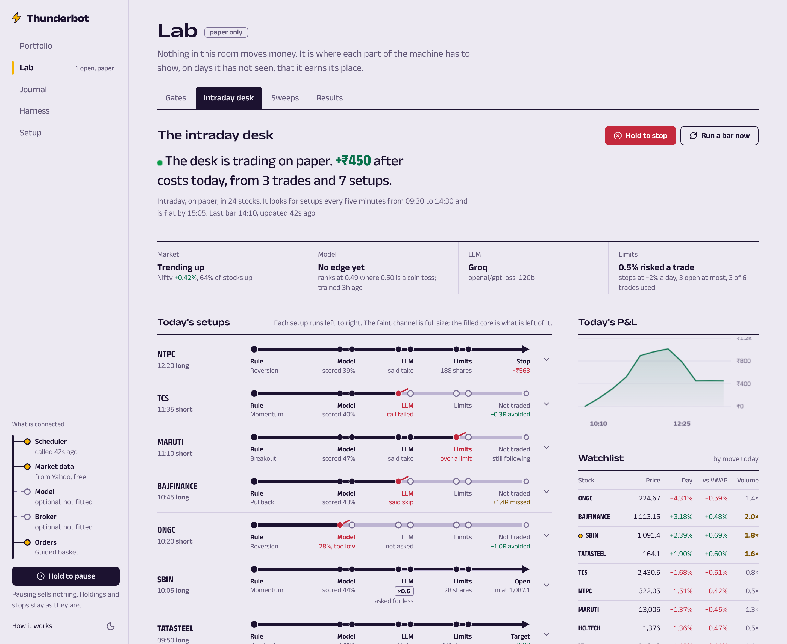
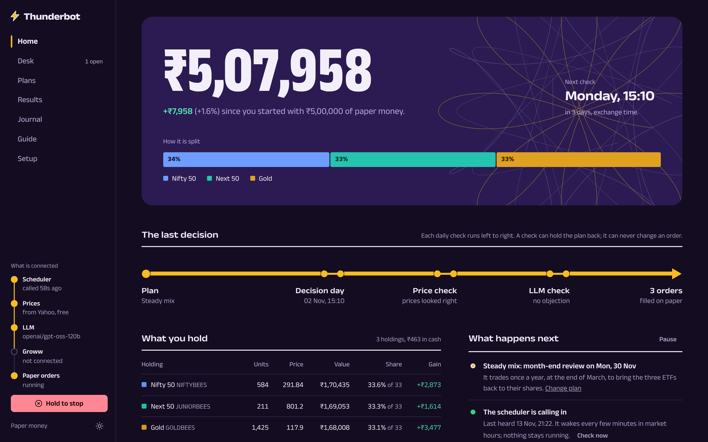
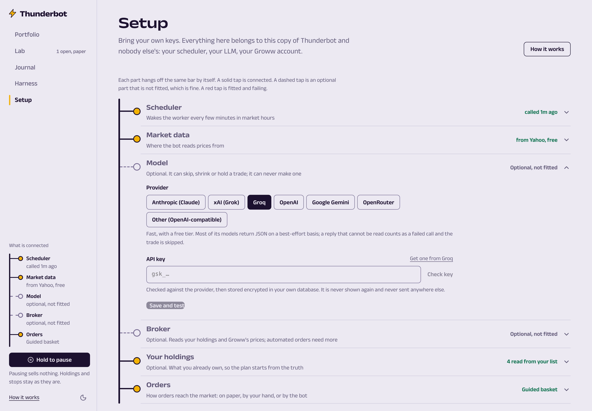

# Thunderbot

A personal investing and trading system for NSE on **Groww**, run from a web cockpit, with no server
to keep alive.

- **Daily ETF strategies** do the real work: a fixed mix of Nifty 50, Next 50 and gold ETFs rebalanced
  once a year, or a trend rotation of the same ETFs that parks in a liquid ETF. One decision a day at
  15:10 IST, a handful of trades a year.
- **A function, not a server.** Supabase's scheduler (every five minutes) and Vercel's own (every fifteen)
  wake a Python function on Vercel in market hours; it does one pass and exits. Setup:
  [`docs/no-server.md`](docs/no-server.md).
- **An honest Lab.** Every backtest is after Groww charges and capital-gains tax by asset class, and is
  shown next to holding the Nifty ETF and next to holding the same ETFs with no timing.
- **An LLM that checks, not predicts.** An optional LLM can postpone a rebalance when prices or orders
  look wrong, and take, skip or shrink an intraday trade. It can never create, change or enlarge one.
- **Bring your own keys.** Paste an LLM key (Claude, Grok, Groq, OpenAI, Gemini, OpenRouter, or any
  OpenAI-compatible server) and a Groww key on the Setup page. Each is checked, then stored encrypted in
  your own database. Nothing saved there can switch on real orders.
- **A desk for intraday.** Four setup generators, a machine-learning model that scores every setup, and
  an LLM that takes or skips it, all under fixed risk limits. It paper-trades
  every five minutes from the same function and shows its reasoning for every decision. On its first run the
  model found no edge and every setup type lost after costs; the desk exists to keep testing that with no
  money at risk. See [`docs/ai-desk.md`](docs/ai-desk.md).

> **No code can guarantee profit.** The research behind this build
> ([`reports/ETF rotation and serverless hosting.md`](reports/ETF%20rotation%20and%20serverless%20hosting.md))
> found that no rotation rule beat simply holding the same ETFs after tax, that a machine-learning market
> filter lost its edge once tax was counted, and that there is no credible evidence for a profitable
> retail intraday bot driven by an LLM or ML model. SEBI found 71% of intraday cash traders lost money in
> FY23. Thunderbot is built to show such results plainly before real money is at risk.

## The grand idea

What is above is what Thunderbot is today. What it is meant to become:

**An open, self-hosted portfolio manager for Indian investors, run by rules, assisted by an LLM, and
defined by a harness its owner can read and edit.** You bring your own broker key and your own LLM key.
You state your goals and limits in plain files. The system proposes what to hold, shows what each choice
would have earned after costs and tax, trades on paper until its own record justifies real money, and
keeps a journal that can show whether every part of it, the LLM included, earned its place.

The harness is everything that shapes a decision and is not the engine: the **policy** (goals, limits,
allowed instruments), the **plans** (rules that decide what to hold), the **roles** (what each LLM call
is for and may return), the **tools** (what data a role may read), the **gates** (tests to pass before
anything gets more authority) and the **journal**. Editing the harness changes what is proposed. It
cannot change what the engine allows.

| Pillar | Today | Still missing |
|---|---|---|
| Honest backtests | After charges and tax, beside the index and a no-timing twin | Correction for trying many settings; survivorship-free stock lists |
| Paper trading | Daily investing and the intraday desk, from a scheduled function | Fills from 5-minute bars flatter liquidity |
| Portfolio management | Fixed-mix and trend plans over a few ETFs | Your actual holdings, goals, risk profile, construction, drift bands, tax-aware rebalancing |
| LLM roles | Three, veto or shrink only, any provider, every prompt and reply journalled | A role that reads text, which is what LLMs are evidenced to do well |
| Measuring the LLM | Every setup followed to its outcome, taken or not | A pass or fail rule set in advance, with a minimum sample |
| Editable harness | Strategy parameters and risk limits | Prompts, roles, plans and gates as versioned files |
| Bring your own keys | A Setup page that checks each key and stores it encrypted in your own database | A one-command install; a setup step for the scheduler |
| Explaining itself | Every decision drawn as a line through its gates; a Guide page in plain words | A plain account of why the portfolio is what it is |

"Anyone can use it" means anyone can run their own copy with their own keys, on paper first. It does not
mean one website holding everyone's broker credentials: Groww's terms, the exchange's static-IP rule and
plain security all rule that out.

The full statement, the rules the design does not bend, the stages, and a **brief for a reviewer** asked
to find what is wrong with the project are in [`docs/vision.md`](docs/vision.md). How a trade actually
happens, in plain words, is in [`docs/how-it-works.md`](docs/how-it-works.md).

## The dashboard

| Page | What it is for |
|---|---|
| **Home** | What the portfolio is worth and how it is split, when the bot checks next, the last daily decision drawn as a line (plan, price check, LLM check, orders), what you hold, and the latest orders as a list to copy into the Groww app. |
| **Desk** | Intraday paper trading. Every setup is one row and one line: rule, model, LLM, limits, order. A break shows who stopped it; a thinner line shows who shrank it; the end shows what it made or what skipping it was worth. Below: the model's out-of-sample report, the desk's notes, and what is still missing before real money. |
| **Plans** | Choose a plan, test it on up to 17 years of real prices after Groww's charges and tax, then use it. Every result is shown next to holding the Nifty 50 ETF and next to holding the same ETFs with no timing. A second tab holds the intraday research tools. |
| **Results** | The portfolio's gain or loss at each daily check, and for anything sold: net result after costs, by day and by holding. For intraday runs: win rate, profit factor, drawdown, and whether the LLM's vetoes did worse than its approvals. |
| **Journal** | Every check, order and warning, newest first, filterable. |
| **Guide** | How it works in plain words: the line under four outcomes, the two bots, each step of a daily check and a desk trade, and what every term on the dashboard means. |
| **Setup** | Bring your own keys. Connect an LLM and Groww, each with a live check; see what is connected as one line; set the plan's and the desk's limits. Live trading can only be switched on where the worker runs, never from the dashboard. |







Phone and dark-mode views are in [`docs/screenshots/`](docs/screenshots/). Designed with Anthropic's open-source
`frontend-design` skill (vendored in `.claude/skills/`); the idea, palette and rationale are in
[`docs/design.md`](docs/design.md). One picture is used everywhere: a decision drawn as a line through gates that
can break it or thin it. Type is Anek Latin by Ek Type; words written by an LLM are always set in Literata
italic so the model's voice is never mistaken for the rules'. Animation by [Motion](https://motion.dev), charts by
TradingView's [Lightweight Charts](https://github.com/tradingview/lightweight-charts).

## Run it on one machine (no cloud, no broker account)

```bash
# 1. worker
cd worker
python -m venv .venv && . .venv/bin/activate
pip install -e ".[all,dev]"
export TB_LOCAL_API_KEY=pick-a-long-random-string
thunderbot serve                                   # local API + research job runner on :8787

# 2. in another terminal: stream a simulated session through the real engine
thunderbot replay --speed 0.3 --reviewer heuristic # synthetic data; watch it trade live

# 3. dashboard
cd dashboard && npm ci
SUPABASE_URL=http://127.0.0.1:8787 SUPABASE_SERVICE_ROLE_KEY=$TB_LOCAL_API_KEY \
DASHBOARD_USER=me DASHBOARD_PASSWORD=secret npm run dev
# open http://localhost:3000
```

Synthetic data is a random walk, so expect every strategy to lose about its costs there. Use it to
learn the tools. For real research, fetch Groww candles (`thunderbot fetch-history`, paid API plan)
and pick **CSV** or **Groww** as the data source in the Lab.

## Production layouts

**No server** (paper trading, backtests, alerts; real orders placed by hand). See
[`docs/no-server.md`](docs/no-server.md).

```
Supabase (free)                                   Vercel (Hobby, Mumbai)
  Postgres + Cron + Vault  ── GET every 5 min ──►  /api/worker (Python)  ──►  one pass, then exit
                           ◄── journal, control ──  dashboard (Next.js)
```

**With a static IP** (needed for live API orders: brokers accept them only from the address registered
to your account). A laptop on a static-IP broadband line, or a small VPS; the dashboard and database
stay where they are.

```
Laptop or Mumbai VPS (static IP, registered with Groww)     Vercel            Supabase
  thunderbot tick --live   (scheduled)  ── journal ──►                   ◄──  Postgres (RLS on)
  thunderbot invest --live (service)    ◄── control ──     dashboard ───────►
```

See [`docs/runbook.md`](docs/runbook.md) for the staged rollout and
[`docs/architecture.md`](docs/architecture.md) for the design.

## Commands

| Command | Purpose |
|---|---|
| `thunderbot tick` | One pass of daily investing, then exit: for Task Scheduler, launchd, systemd timers, CI |
| `thunderbot invest` | Daily investing as a long-running worker (`--live` for real orders) |
| `thunderbot invest-backtest --strategy etf_trend` | Backtest a daily strategy after costs and tax |
| `thunderbot serve` | Local stand-in for Supabase (PostgREST subset over SQLite) + job runner |
| `thunderbot replay` | Replay history through the real engine and paper broker (`--speed`, `--reviewer`) |
| `thunderbot jobs` | Run dashboard research jobs against Supabase (production) |
| `thunderbot paper` / `live` | Run the trading engine against Groww |
| `thunderbot backtest --data DIR` | CLI backtest over CSV candles |
| `thunderbot fetch-history` | Download candles from Groww, paginated per Groww's window limits |
| `thunderbot kill` / `pause` / `resume` / `confirm-login` | Control plane (also in the dashboard) |
| `thunderbot login-check` | Read-only Groww credential check (login, profile, data plan); never trades |
| `thunderbot check-ip` | Verify the public IP is the whitelisted static IP |

Live trading needs three explicit opt-ins on the VPS: `TB_LIVE_TRADING_ENABLED=true`, a
`TB_EXPECTED_STATIC_IP` that matches the host's IP, and `thunderbot live --i-understand-the-risks`.

## Repository

```
worker/      Python package: daily and intraday strategies, backtesters, paper and Groww brokers,
             reviewers, the serverless entry point, the desk, the key store, local API, CLI. 196 tests.
dashboard/   Next.js cockpit (API routes keep the service key server-side; Basic Auth)
             api/worker.py is the Python function that runs the worker on Vercel
supabase/    Postgres schema and the pg_cron / pg_net / Vault scheduler
docs/        no-server setup, runbook, architecture
reports/     the research behind the design, with sources; notes in research_notes/
```
