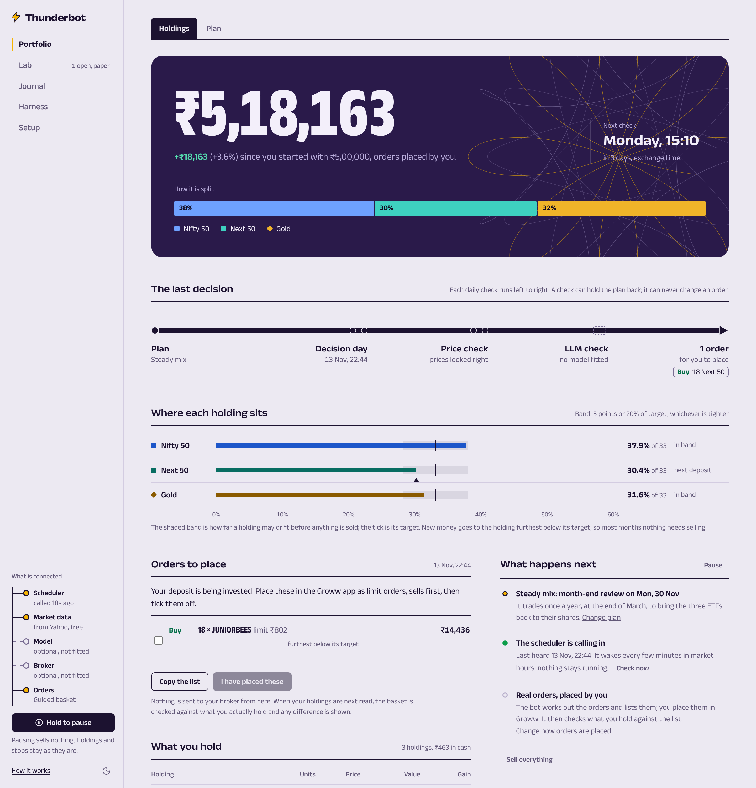
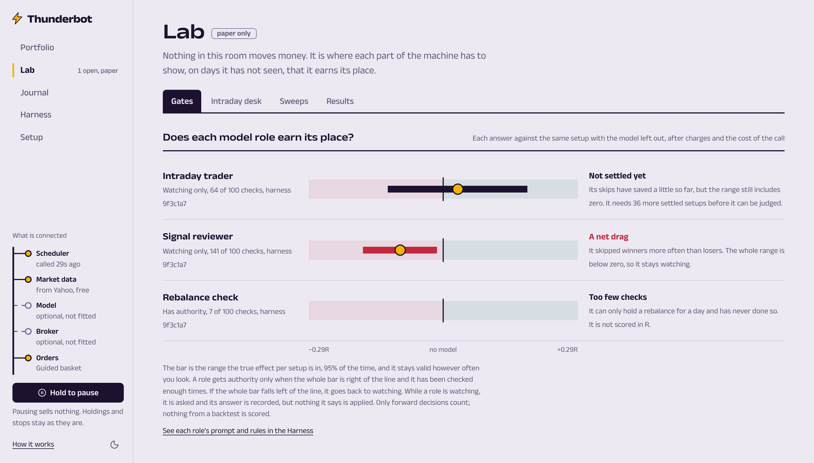
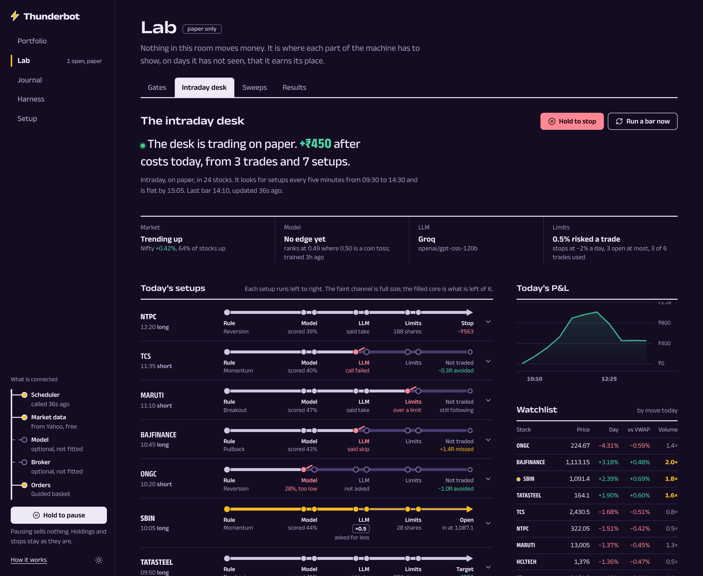
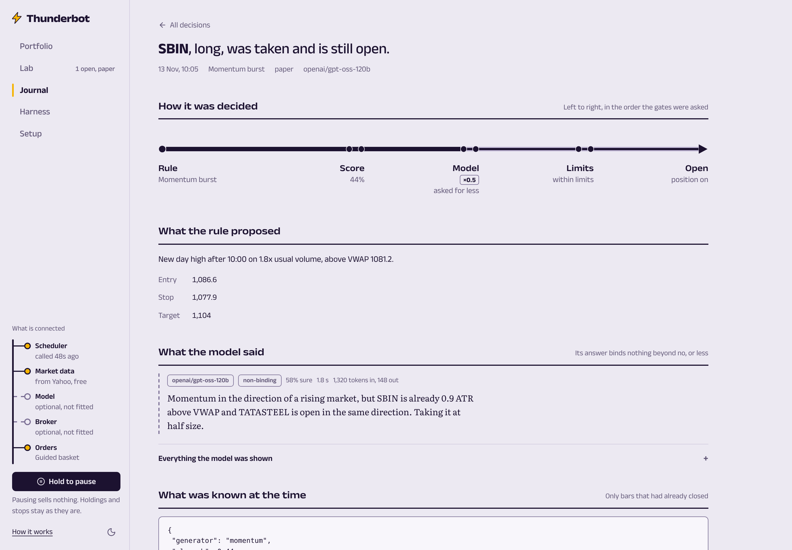

# Thunderbot

A portfolio manager for NSE that you run yourself, on **Groww**, with no server to keep alive. Rules
decide; an LLM may only say no, less or later; and a journal shows whether each part earned its place.

- **A portfolio, not a script.** It works from what you actually hold, shows how far each holding has
  drifted from its target, routes new money to whatever is furthest below target so most months nothing
  is sold, and plans the year's tax-free gain harvest.
- **Three ways to place orders.** On paper; as a **guided basket** the bot works out and you place by hand
  in Groww, which needs no fixed IP; or automated, which the broker accepts only from your registered
  static IP and which nothing on the dashboard can switch on.
- **A function, not a server.** Supabase's scheduler wakes a Python function on Vercel in market hours;
  it does one pass and exits. Setup: [`docs/no-server.md`](docs/no-server.md).
- **A harness you can read.** Your limits, the plan, each LLM role's prompt and the tests a role must pass
  are plain files with a version id that is stamped on every decision. See [`docs/harness.md`](docs/harness.md).
- **A model earns its authority.** Every LLM answer is scored against the same setup with the model left
  out, after charges and the cost of the call. A role is only obeyed once the evidence says it helps, and
  is sent back to watching if it stops helping.
- **An honest Lab.** Backtests are after Groww charges and capital-gains tax by asset class, beside holding
  the Nifty ETF and beside the same ETFs with no timing. Parameter sweeps are marked down for every
  setting ever tried on the data.
- **Bring your own keys.** Paste an LLM key (Claude, Grok, Groq, OpenAI, Gemini, OpenRouter, or any
  OpenAI-compatible server) and a Groww key on the Setup page. Each is checked, then stored encrypted in
  your own database.
- **An intraday desk, kept in the Lab.** Four setup generators, a small model that scores each setup, and
  an LLM that takes or skips it. It paper-trades every five minutes. Its first model found no edge and
  every setup type lost after costs; it stays in the Lab to keep testing that with no money at risk.
  See [`docs/ai-desk.md`](docs/ai-desk.md).

> **No code can guarantee profit.** The research behind this build
> ([`reports/ETF rotation and serverless hosting.md`](reports/ETF%20rotation%20and%20serverless%20hosting.md))
> found that no rotation rule beat simply holding the same ETFs after tax, that a machine-learning market
> filter lost its edge once tax was counted, and that there is no credible evidence for a profitable
> retail intraday bot driven by an LLM or ML model. SEBI found 71% of intraday cash traders lost money in
> FY23. Thunderbot is built to show such results plainly before real money is at risk.

## The grand idea

What is above is what Thunderbot is today. What it is meant to become:

**An open, self-hosted portfolio manager for Indian investors, run by rules, assisted by an LLM, and
defined by a harness its owner can read and edit.** You bring your own broker key and your own LLM key.
You state your goals and limits in plain files. The system proposes what to hold, shows what each choice
would have earned after costs and tax, trades on paper until its own record justifies real money, and
keeps a journal that can show whether every part of it, the LLM included, earned its place.

The harness is everything that shapes a decision and is not the engine: the **policy** (goals, limits,
allowed instruments), the **plans** (rules that decide what to hold), the **roles** (what each LLM call
is for and may return), the **tools** (what data a role may read), the **gates** (tests to pass before
anything gets more authority) and the **journal**. Editing the harness changes what is proposed. It
cannot change what the engine allows.

| Pillar | Today | Still missing |
|---|---|---|
| Honest backtests | After charges and tax, beside the index and a no-timing twin; sweeps report a deflated Sharpe and the odds the winner was picked by luck | Survivorship-free stock lists |
| Paper trading | Daily investing and the intraday desk, from a scheduled function | Fills from 5-minute bars flatter liquidity |
| Portfolio management | Your actual holdings; drift corridors; deposits routed with no sales; a tax-year harvest plan; guided baskets | Goals and a risk profile; statement import; construction beyond fixed weights |
| LLM roles | Four, veto, shrink or postpone only, any provider, every prompt and reply journalled | A role that reads text (filings, results), which is what LLMs are evidenced to do well |
| Measuring the LLM | Each answer scored against the same setup without the model, with a confidence range that stays valid however often you look; promotion and demotion are automatic | Enough forward decisions to settle anything |
| Editable harness | Policy, plans, roles, prompts and gates as files, validated against the engine's ceilings, with an id on every decision | Editing them from the dashboard; goals in the policy |
| Bring your own keys | A Setup page that checks each key and stores it encrypted in your own database | A one-command install; a setup step for the scheduler |
| Explaining itself | Every decision drawn as a trace through its gates, with its own page; a Guide in plain words | A plain account of why the portfolio is what it is |

"Anyone can use it" means anyone can run their own copy with their own keys, on paper first. It does not
mean one website holding everyone's broker credentials: Groww's terms, the exchange's static-IP rule and
plain security all rule that out.

The full statement, the rules the design does not bend, the stages, and a **brief for a reviewer** asked
to find what is wrong with the project are in [`docs/vision.md`](docs/vision.md). How a trade actually
happens, in plain words, is in [`docs/how-it-works.md`](docs/how-it-works.md).

## The dashboard

| Place | What it is for |
|---|---|
| **Portfolio** | What it is worth and how it is split; the last daily decision drawn as a trace (plan, price check, LLM check, orders); a drift corridor for each holding; the orders to place, as a checklist; adding money; the tax year. A second tab chooses and tests the plan on up to 17 years of prices. |
| **Lab** (paper only) | Whether each model role has earned authority, drawn as a range across a "no model" line; the intraday desk, one trace per setup; parameter sweeps; results. |
| **Journal** | Every setup the rules proposed, what each gate did with it and what it went on to do; what the gates were worth in total; one page per decision with what it knew, what the model said and how it ended; every event and order. |
| **Harness** | The files that shape a decision, each role's standing, and the ceilings no file can raise. |
| **Setup** | What is connected; your keys, each with a live check; your holdings; how orders are placed; the limits; how it works in plain words. |









Phone views and the other pages are in [`docs/screenshots/`](docs/screenshots/). Designed with Anthropic's open-source
`frontend-design` skill (vendored in `.claude/skills/`); the idea, the measured palette and the rationale are in
[`docs/design.md`](docs/design.md). A decision is always drawn the same way: a conductor through gates that can
narrow it, hold it or break it, and never widen it. Type is Anek Latin by Ek Type; words written by an LLM are
always set in Literata so the model's voice is never mistaken for the rules'. Animation by
[Motion](https://motion.dev), charts by TradingView's [Lightweight Charts](https://github.com/tradingview/lightweight-charts).

## Run it on one machine (no cloud, no broker account)

```bash
# 1. worker
cd worker
python -m venv .venv && . .venv/bin/activate
pip install -e ".[all,dev]"
export TB_LOCAL_API_KEY=pick-a-long-random-string
thunderbot serve                                   # local API + research job runner on :8787

# 2. in another terminal: stream a simulated session through the real engine
thunderbot replay --speed 0.3 --reviewer heuristic # synthetic data; watch it trade live

# 3. dashboard
cd dashboard && npm ci
SUPABASE_URL=http://127.0.0.1:8787 SUPABASE_SERVICE_ROLE_KEY=$TB_LOCAL_API_KEY \
DASHBOARD_USER=me DASHBOARD_PASSWORD=secret npm run dev
# open http://localhost:3000
```

Synthetic data is a random walk, so expect every strategy to lose about its costs there. Use it to
learn the tools. For real research, fetch Groww candles (`thunderbot fetch-history`, paid API plan)
and pick **CSV** or **Groww** as the data source in the Lab.

## Production layouts

**No server** (paper trading, backtests, alerts; real orders placed by hand). See
[`docs/no-server.md`](docs/no-server.md).

```
Supabase (free)                                   Vercel (Hobby, Mumbai)
  Postgres + Cron + Vault  ── GET every 5 min ──►  /api/worker (Python)  ──►  one pass, then exit
                           ◄── journal, control ──  dashboard (Next.js)
```

**With a static IP** (needed for live API orders: brokers accept them only from the address registered
to your account). A laptop on a static-IP broadband line, or a small VPS; the dashboard and database
stay where they are.

```
Laptop or Mumbai VPS (static IP, registered with Groww)     Vercel            Supabase
  thunderbot tick --live   (scheduled)  ── journal ──►                   ◄──  Postgres (RLS on)
  thunderbot invest --live (service)    ◄── control ──     dashboard ───────►
```

To deploy: [`ref.md`](ref.md) lists the Supabase and Vercel steps in order (all seven migrations in
`supabase/migrations/`, the Vault secrets, the Vercel environment). Vercel deploys `main`; migrations are
not applied by a push, so run `supabase db push` whenever a new file appears there.

See [`docs/runbook.md`](docs/runbook.md) for the staged rollout and
[`docs/architecture.md`](docs/architecture.md) for the design.

## Commands

| Command | Purpose |
|---|---|
| `thunderbot tick` | One pass of daily investing, then exit: for Task Scheduler, launchd, systemd timers, CI |
| `thunderbot invest` | Daily investing as a long-running worker (`--live` for real orders) |
| `thunderbot invest-backtest --strategy etf_trend` | Backtest a daily strategy after costs and tax |
| `thunderbot serve` | Local stand-in for Supabase (PostgREST subset over SQLite) + job runner |
| `thunderbot replay` | Replay history through the real engine and paper broker (`--speed`, `--reviewer`) |
| `thunderbot jobs` | Run dashboard research jobs against Supabase (production) |
| `thunderbot paper` / `live` | Run the trading engine against Groww |
| `thunderbot backtest --data DIR` | CLI backtest over CSV candles |
| `thunderbot fetch-history` | Download candles from Groww, paginated per Groww's window limits |
| `thunderbot kill` / `pause` / `resume` / `confirm-login` | Control plane (also in the dashboard) |
| `thunderbot login-check` | Read-only Groww credential check (login, profile, data plan); never trades |
| `thunderbot check-ip` | Verify the public IP is the whitelisted static IP |

Live trading needs three explicit opt-ins on the VPS: `TB_LIVE_TRADING_ENABLED=true`, a
`TB_EXPECTED_STATIC_IP` that matches the host's IP, and `thunderbot live --i-understand-the-risks`.

## Repository

```
worker/          Python package: daily and intraday strategies, backtesters, paper and Groww brokers,
                 reviewers, the serverless entry point, the desk, the harness and its gates, the key store,
                 local API, CLI. 246 tests.
dashboard/       Next.js cockpit (API routes keep the service key server-side; Basic Auth)
                 api/worker.py is the Python function that runs the worker on Vercel
supabase/        Postgres schema (seven migrations) and the pg_cron / pg_net / Vault scheduler
ref.md           deploy reference: Supabase and Vercel, step by step
docs/            vision, how-it-works, harness, ai-desk, no-server setup, runbook, architecture, design,
                 research report, screenshots
reports/         the research behind the design, with sources
research_notes/  working notes behind the reports
```
