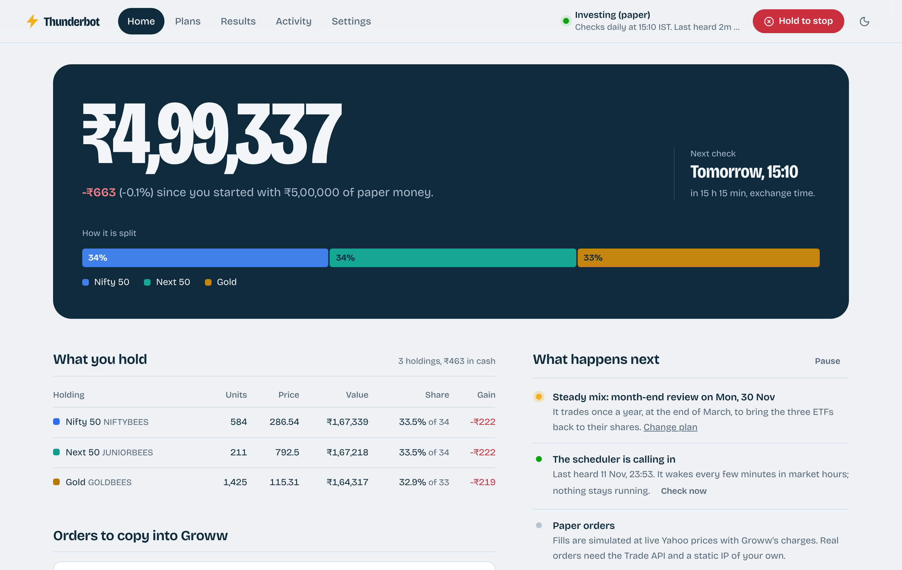
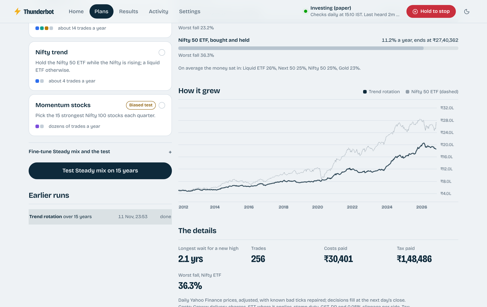

# Thunderbot

A personal investing and trading system for NSE on **Groww**, run from a web cockpit, with no server
to keep alive.

- **Daily ETF strategies** do the real work: a fixed mix of Nifty 50, Next 50 and gold ETFs rebalanced
  once a year, or a trend rotation of the same ETFs that parks in a liquid ETF. One decision a day at
  15:10 IST, a handful of trades a year.
- **A function, not a server.** Supabase's scheduler (every five minutes) and Vercel's own (every fifteen)
  wake a Python function on Vercel in market hours; it does one pass and exits. Setup:
  [`docs/no-server.md`](docs/no-server.md).
- **An honest Lab.** Every backtest is after Groww charges and capital-gains tax by asset class, and is
  shown next to holding the Nifty ETF and next to holding the same ETFs with no timing.
- **An LLM that checks, not predicts.** An optional Claude reviewer can postpone a rebalance when prices
  or orders look wrong. It can never create, change or enlarge a trade.
- **Intraday strategies** (opening-range breakout, VWAP reversion, EMA pullback) remain for paper trading
  and research. They lost money in our tests and are not recommended.

> **No code can guarantee profit.** The research behind this build
> ([`reports/ETF rotation and serverless hosting.md`](reports/ETF%20rotation%20and%20serverless%20hosting.md))
> found that no rotation rule beat simply holding the same ETFs after tax, that a machine-learning market
> filter lost its edge once tax was counted, and that there is no credible evidence for a profitable
> retail intraday bot driven by an LLM or ML model. SEBI found 71% of intraday cash traders lost money in
> FY23. Thunderbot is built to show such results plainly before real money is at risk.

## The dashboard

| Page | What it is for |
|---|---|
| **Home** | What the portfolio is worth and how it is split, when the bot checks next, what you hold, the latest orders as a list to copy into the Groww app, and whether the scheduler is calling in. A first visit shows three steps: wake the worker, choose a plan, start. **Start** and hold-to-stop are always in the top bar. |
| **Plans** | Choose a plan, test it on up to 17 years of real prices after Groww's charges and tax, then use it. Every result is shown next to holding the Nifty 50 ETF and next to holding the same ETFs with no timing. A second tab holds the intraday research tools (backtests and walk-forward sweeps). |
| **Results** | The portfolio's gain or loss at each daily check, and for anything sold: net result after costs, by day and by holding. For intraday runs: win rate, profit factor, drawdown, and whether the reviewer's vetoes did worse than its approvals. |
| **Activity** | Every check, order and warning, newest first, filterable. |
| **Settings** | A checklist of what is connected (scheduler, prices, alerts, reviewer, Groww, static IP), how the investing plan runs, and the limits for intraday research. Live trading and credentials can only be set where the worker runs, never from the dashboard. |





Phone and dark-mode views are in [`docs/screenshots/`](docs/screenshots/). Designed with Anthropic's open-source
`frontend-design` skill (vendored in `.claude/skills/`); the plan, palette and rationale are in
[`docs/design.md`](docs/design.md). One typeface (Bricolage Grotesque), light and dark themes, a colour per holding
checked for colour-blind separation, animation by [Motion](https://motion.dev), charts by TradingView's
[Lightweight Charts](https://github.com/tradingview/lightweight-charts).

## Run it on one machine (no cloud, no broker account)

```bash
# 1. worker
cd worker
python -m venv .venv && . .venv/bin/activate
pip install -e ".[all,dev]"
export TB_LOCAL_API_KEY=pick-a-long-random-string
thunderbot serve                                   # local API + research job runner on :8787

# 2. in another terminal: stream a simulated session through the real engine
thunderbot replay --speed 0.3 --reviewer heuristic # synthetic data; watch it trade live

# 3. dashboard
cd dashboard && npm ci
SUPABASE_URL=http://127.0.0.1:8787 SUPABASE_SERVICE_ROLE_KEY=$TB_LOCAL_API_KEY \
DASHBOARD_USER=me DASHBOARD_PASSWORD=secret npm run dev
# open http://localhost:3000
```

Synthetic data is a random walk, so expect every strategy to lose about its costs there. Use it to
learn the tools. For real research, fetch Groww candles (`thunderbot fetch-history`, paid API plan)
and pick **CSV** or **Groww** as the data source in the Lab.

## Production layouts

**No server** (paper trading, backtests, alerts; real orders placed by hand). See
[`docs/no-server.md`](docs/no-server.md).

```
Supabase (free)                                   Vercel (Hobby, Mumbai)
  Postgres + Cron + Vault  ── GET every 5 min ──►  /api/worker (Python)  ──►  one pass, then exit
                           ◄── journal, control ──  dashboard (Next.js)
```

**With a static IP** (needed for live API orders: brokers accept them only from the address registered
to your account). A laptop on a static-IP broadband line, or a small VPS; the dashboard and database
stay where they are.

```
Laptop or Mumbai VPS (static IP, registered with Groww)     Vercel            Supabase
  thunderbot tick --live   (scheduled)  ── journal ──►                   ◄──  Postgres (RLS on)
  thunderbot invest --live (service)    ◄── control ──     dashboard ───────►
```

See [`docs/runbook.md`](docs/runbook.md) for the staged rollout and
[`docs/architecture.md`](docs/architecture.md) for the design.

## Commands

| Command | Purpose |
|---|---|
| `thunderbot tick` | One pass of daily investing, then exit: for Task Scheduler, launchd, systemd timers, CI |
| `thunderbot invest` | Daily investing as a long-running worker (`--live` for real orders) |
| `thunderbot invest-backtest --strategy etf_trend` | Backtest a daily strategy after costs and tax |
| `thunderbot serve` | Local stand-in for Supabase (PostgREST subset over SQLite) + job runner |
| `thunderbot replay` | Replay history through the real engine and paper broker (`--speed`, `--reviewer`) |
| `thunderbot jobs` | Run dashboard research jobs against Supabase (production) |
| `thunderbot paper` / `live` | Run the trading engine against Groww |
| `thunderbot backtest --data DIR` | CLI backtest over CSV candles |
| `thunderbot fetch-history` | Download candles from Groww, paginated per Groww's window limits |
| `thunderbot kill` / `pause` / `resume` / `confirm-login` | Control plane (also in the dashboard) |
| `thunderbot login-check` | Read-only Groww credential check (login, profile, data plan); never trades |
| `thunderbot check-ip` | Verify the public IP is the whitelisted static IP |

Live trading needs three explicit opt-ins on the VPS: `TB_LIVE_TRADING_ENABLED=true`, a
`TB_EXPECTED_STATIC_IP` that matches the host's IP, and `thunderbot live --i-understand-the-risks`.

## Repository

```
worker/      Python package: daily and intraday strategies, backtesters, paper and Groww brokers,
             reviewers, the serverless entry point, local API, CLI. 147 tests.
dashboard/   Next.js cockpit (API routes keep the service key server-side; Basic Auth)
             api/worker.py is the Python function that runs the worker on Vercel
supabase/    Postgres schema and the pg_cron / pg_net / Vault scheduler
docs/        no-server setup, runbook, architecture
reports/     the research behind the design, with sources; notes in research_notes/
```
