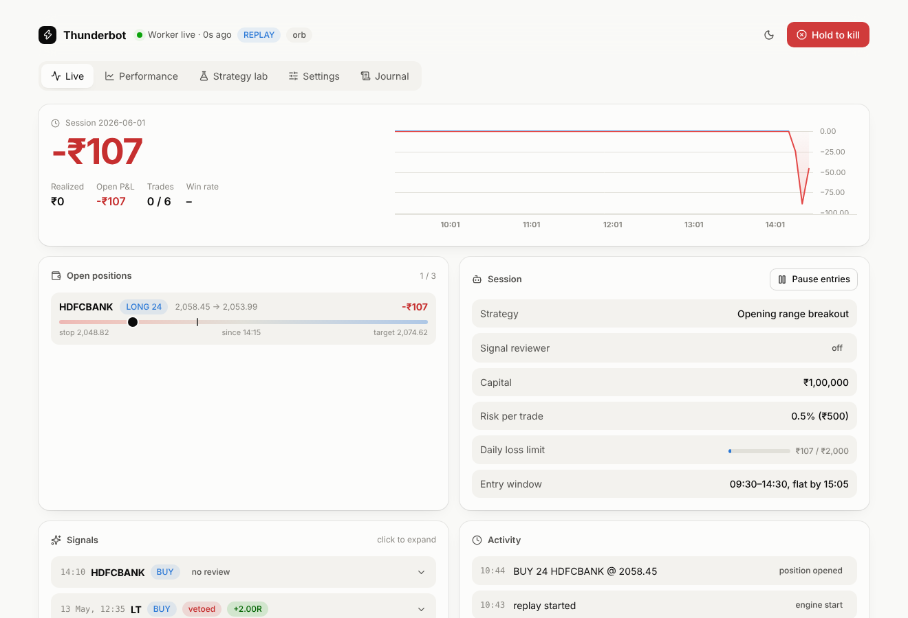

# Thunderbot

A personal trading system for NSE cash equities on **Groww's Trade API**, run from an animated
web cockpit. Built from the blueprint in [`docs/research-report.md`](docs/research-report.md).

- **Deterministic strategies** generate every signal: Opening Range Breakout, VWAP reversion and
  EMA trend pullback, all on 5-minute bars.
- A **signal reviewer** (Claude, or a free rule-based baseline) can veto a signal or shrink its
  size. It can never create a trade, enlarge one, or move its prices.
- **Hard risk limits** run last and always win: daily loss halt, position and trade caps,
  fixed-fractional sizing, leverage ceiling, kill switch, 3:05 PM flatten.
- **SEBI retail-algo compliance** (April 2026 framework): static-IP check, order throttle capped
  below 10 orders/second, daily login confirmation, marketable-limit orders, and a full audit journal.

> **No code can guarantee profit.** SEBI found that 71% of individual intraday cash traders lost
> money in FY23. Thunderbot is built to find out *honestly* whether a strategy has an edge before
> real money is at risk. The Lab's walk-forward test, the shadow outcome of every signal, and the
> paper-then-live staging all exist for that. Most configurations will fail those tests; that is
> the tool working.

## The cockpit

| Tab | What it does |
|---|---|
| **Live** | Session P&L with an intraday curve, open positions with a live stop-to-target gauge, the signal feed with reviewer verdicts and how each signal played out, activity, and pause/resume. Hold-to-kill switch in the header. |
| **Performance** | Paper / live / replay results: net P&L after costs, win rate, profit factor, expectancy, drawdown, cumulative and daily P&L charts, breakdowns by strategy and symbol, and **"Is the reviewer earning its keep?"**, which compares vetoed and approved signals by average R. |
| **Strategy lab** | Backtests and **walk-forward sweeps** run on the worker with the live engine's own code. Sweeps rank parameter sets on the first 70% of history and show how each did on the unseen last 30%. Promote a configuration to the engine in one click; configs that didn't hold up out-of-sample need a second, deliberate click. |
| **Settings** | Strategy and parameters, capital and risk limits, universe and timing, reviewer. The worker validates and clamps everything. Live trading, MTF, the static IP and credentials are locked to the VPS environment, so the dashboard can never switch them on. |
| **Journal** | Every event and order state, filterable. |



Minimal UI, light and dark themes, spring animations (open-source [Motion](https://motion.dev)),
charts by TradingView's open-source [Lightweight Charts](https://github.com/tradingview/lightweight-charts).

## Run it on one machine (no cloud, no broker account)

```bash
# 1. worker
cd worker
python -m venv .venv && . .venv/bin/activate
pip install -e ".[all,dev]"
export TB_LOCAL_API_KEY=pick-a-long-random-string
thunderbot serve                                   # local API + research job runner on :8787

# 2. in another terminal: stream a simulated session through the real engine
thunderbot replay --speed 0.3 --reviewer heuristic # synthetic data; watch it trade live

# 3. dashboard
cd dashboard && npm ci
SUPABASE_URL=http://127.0.0.1:8787 SUPABASE_SERVICE_ROLE_KEY=$TB_LOCAL_API_KEY \
DASHBOARD_USER=me DASHBOARD_PASSWORD=secret npm run dev
# open http://localhost:3000
```

Synthetic data is a random walk, so expect every strategy to lose about its costs there. Use it to
learn the tools. For real research, fetch Groww candles (`thunderbot fetch-history`, paid API plan)
and pick **CSV** or **Groww** as the data source in the Lab.

## Production layout

```
Mumbai VPS (static IP, whitelisted on Groww)          Vercel                Supabase
  thunderbot paper|live  ── journal + heartbeat ──►                   ◄──  Postgres (RLS on)
  thunderbot jobs        ◄── queued backtests ────    dashboard  ──────►  control: kill/pause/settings
```

See [`docs/runbook.md`](docs/runbook.md) for the staged rollout (backtest, paper for 4-8 weeks,
tiny live, scale) and [`docs/architecture.md`](docs/architecture.md) for the design.

## Commands

| Command | Purpose |
|---|---|
| `thunderbot serve` | Local stand-in for Supabase (PostgREST subset over SQLite) + job runner |
| `thunderbot replay` | Replay history through the real engine and paper broker (`--speed`, `--reviewer`) |
| `thunderbot jobs` | Run dashboard research jobs against Supabase (production) |
| `thunderbot paper` / `live` | Run the trading engine against Groww |
| `thunderbot backtest --data DIR` | CLI backtest over CSV candles |
| `thunderbot fetch-history` | Download candles from Groww, paginated per Groww's window limits |
| `thunderbot kill` / `pause` / `resume` / `confirm-login` | Control plane (also in the dashboard) |
| `thunderbot check-ip` | Verify the public IP is the whitelisted static IP |

Live trading needs three explicit opt-ins on the VPS: `TB_LIVE_TRADING_ENABLED=true`, a
`TB_EXPECTED_STATIC_IP` that matches the host's IP, and `thunderbot live --i-understand-the-risks`.

## Repository

```
worker/      Python engine: strategies, reviewer, risk, Groww + paper brokers, backtester,
             replay, jobs, local API, CLI. 88 tests.
dashboard/   Next.js cockpit (API routes keep the service key server-side; Basic Auth)
supabase/    Postgres schema migrations
docs/        research report, architecture, runbook
```
