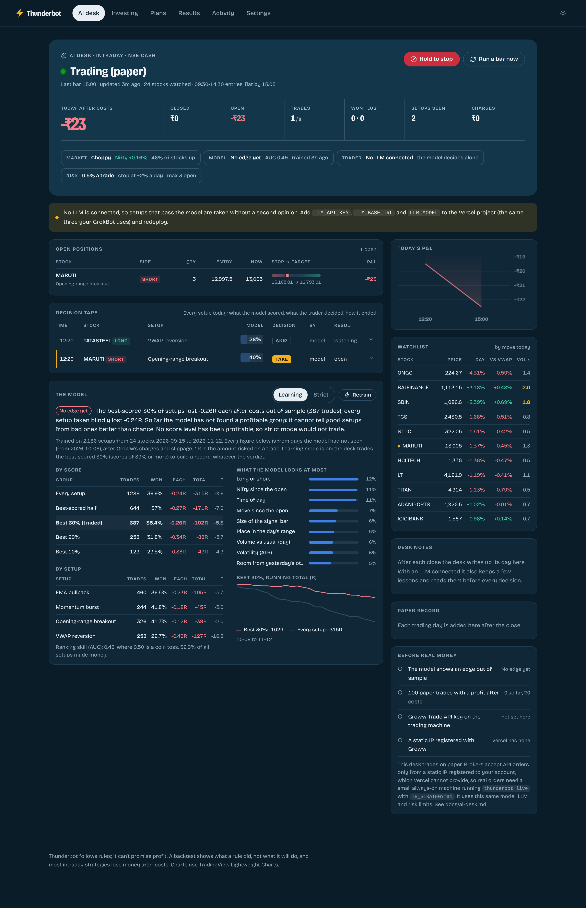

# The AI desk

Intraday trading on NSE cash, decided by a machine-learning model and an LLM, under fixed risk limits.
It trades **on paper** from the Vercel function that already runs the daily investing worker. Real orders
through Groww need one more machine; see [Going live](#going-live).



## What it found on its first run

Read this before anything else. On 12 November 2026 the desk was trained on every setup its four
generators produced in 24 liquid Nifty 50 stocks over the previous 60 days (2,186 setups), and judged
only on days the model had not seen:

| | Trades | Won | Each, after costs |
|---|---|---|---|
| Every setup, taken blindly | 1,288 | 37% | −0.24R |
| The model's best-scored 30% | 387 | 35% | −0.26R |

1R is the amount risked on a trade. The model's ranking skill was AUC 0.49, where 0.50 is a coin toss.
No setup type made money, and the model could not tell good setups from bad ones. Almost all of the loss
is costs: Groww's charges and slippage come to about 0.2% of a position per round trip and the setups have
no edge before costs. With the generators' original stops (about 0.3% away) the loss across all 2,186
setups was −0.73R a trade; widening every stop to at least 0.8% cut it to −0.26R, which is why the desk
does that.

This matches the published evidence collected in `reports/`: no study shows a retail intraday system,
with or without ML or an LLM, making money after costs on data like this. The desk is built so that
you can watch that question being answered with your own numbers and no money at risk. Its report says
in words whether an edge has appeared, and it retrains every evening.

## How a trade is decided

```
every 5 minutes, 09:30-14:30 IST
  4 generators ──► setup (entry, stop, target fixed here)
                     │  opening-range breakout · VWAP reversion · EMA pullback · momentum burst
                     ▼
  model ──────────► probability of a profit after costs, from 32 features of that bar
                     │  below the floor: skipped, but still followed to its outcome
                     ▼
  LLM trader ─────► take or skip, and a size from 0 to 1 (never above 1, never a price)
                     ▼
  risk manager ───► size from the risk per trade; daily loss limit; max positions; entry window
                     ▼
  paper fill at the last price, stop and target checked on every later bar, flat by 15:05
```

- **Generators** (`worker/thunderbot/strategy/`) are plain rules. Each fires at most once per stock per
  day. Stops closer than 0.8% are widened and the target moved to keep the same reward-to-risk.
- **Features** (`ai/features.py`) use only bars that had closed: recent returns, distance from VWAP,
  volatility, volume against the same time on earlier days, RSI, the opening range, yesterday's high and
  low, the Nifty's move and the stock's strength against it, time of day. Directional features are
  signed so that positive means "in the direction of the trade".
- **The model** (`ai/gbm.py`) is 60 gradient-boosted trees of depth 2, written out in this repository:
  numpy to train, plain Python to predict, stored as JSON in the `models` table. It is small on purpose;
  a larger one scored worse than chance out of sample.
- **Training** (`ai/train.py`) is walk-forward: fit on all days before a block of five, score that block,
  move on. Labels are real outcomes with the backtester's fills (next bar's open, stop before target in
  the same bar, flat at 15:05), slippage and charges. The saved model is then fitted on every day.
- **The LLM** (`llm/trader.py`) is any OpenAI-compatible chat endpoint. It sees the setup, the model's
  score and track record, the market so far today, the last hour of bars, the account's day, and the
  lessons from earlier sessions. Its prompt and reply are stored with every decision. If the call fails
  the trade is skipped (`TB_LLM_FAIL_MODE=reject`).
- **Every setup is followed** to its stop, target or the close whether or not it was taken, so the tape
  shows what each skip was worth.
- **After the close** the desk records the day, asks the LLM for a short review and up to four lessons
  (kept in the control row `ai_memory`, the newest eight shown to the trader), and queues a retrain.

### Learning and Strict

- **Learning** (default): trade the best-scored 30% of setups whatever the report says, so that there is
  a paper record. Expect it to lose about a quarter of the risk on each trade until an edge appears.
- **Strict**: trade only setups the model expects to make money. On the first report no score level was
  profitable, so Strict would not have traded at all.

## Set it up

Nothing new to deploy: the desk runs inside `/api/worker` on each scheduled call.

1. Apply `supabase/migrations/20261112000000_ai_desk.sql` (a `models` table and the `train` job kind).
2. In the Vercel project, add the LLM (optional; without it the model decides alone):

   | Variable | Example |
   |---|---|
   | `LLM_API_KEY` | your key |
   | `LLM_BASE_URL` | `https://api.x.ai/v1`, `https://api.groq.com/openai/v1`, `https://api.openai.com/v1` |
   | `LLM_MODEL` | the model's id at that provider |

   Optional: `TB_AI_SYMBOLS` (comma-separated NSE symbols; the default is 24 liquid Nifty 50 names),
   `TB_LLM_ENABLED=false` to switch the LLM off while leaving the key in place.
3. Redeploy, open the dashboard's **AI desk** and press **Start paper trading**. The first call trains a
   model (under a minute). Risk limits are the ones on the Settings page.

Supabase's scheduler calls the worker every five minutes in market hours, which is what the desk needs.
Vercel's own 15-minute schedule is too coarse by itself; keep the Supabase scheduler connected.

## Going live

The desk on Vercel cannot place real orders. Since 1 April 2026 brokers accept API orders only from a
static IP registered to the account, and a serverless function has no address of its own
(`docs/no-server.md`, "What needs a static IP").

For real orders, run the trading engine on a machine with such an address (a small Mumbai VPS, or a
home line with a static IP). It uses the same generators, the same model (read from Supabase at the
start of each day) and the same LLM:

```bash
# /etc/thunderbot.env on that machine (see worker/.env.example)
TB_STRATEGY=ai
GROWW_API_KEY=...            GROWW_TOTP_SECRET=...
TB_EXPECTED_STATIC_IP=...    TB_LIVE_TRADING_ENABLED=true
LLM_API_KEY=...              LLM_BASE_URL=...            LLM_MODEL=...
SUPABASE_URL=...             SUPABASE_SERVICE_ROLE_KEY=...

thunderbot paper                              # first: the engine on Groww's live prices, simulated orders
thunderbot live --i-understand-the-risks      # real MIS orders, each with a stop order at the broker
```

`docs/runbook.md` has the staged rollout. The dashboard's "Before real money" list shows where you
stand: an out-of-sample edge in the model's report, and at least 100 paper trades with a profit after
costs. Neither is true yet. The engine does not enforce that list; the three live-trading switches
above are yours to turn.

## What to check when it looks wrong

| Symptom | Likely cause |
|---|---|
| "No LLM connected" | The three `LLM_*` variables are not all set for Production, or the deployment predates them. |
| Every decision says "LLM error" | Wrong key, base URL or model id; the message is in the tape row. |
| No setups all day | Normal on quiet days. The generators fire a few dozen times a day across 24 stocks; the floor passes about a third. |
| "No prices from Yahoo" | Yahoo refused the function's address for a while. The desk tries again on the next bar. |
| The model card says training failed | Open Activity for the error. Fewer than 20 trading days of history, or Yahoo returned nothing. |
